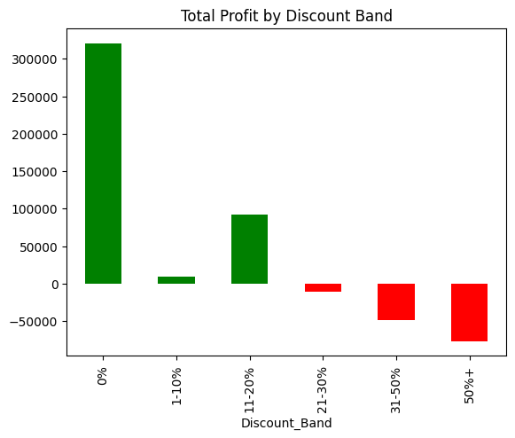
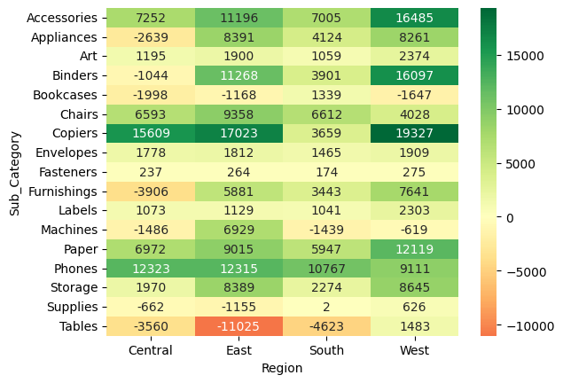
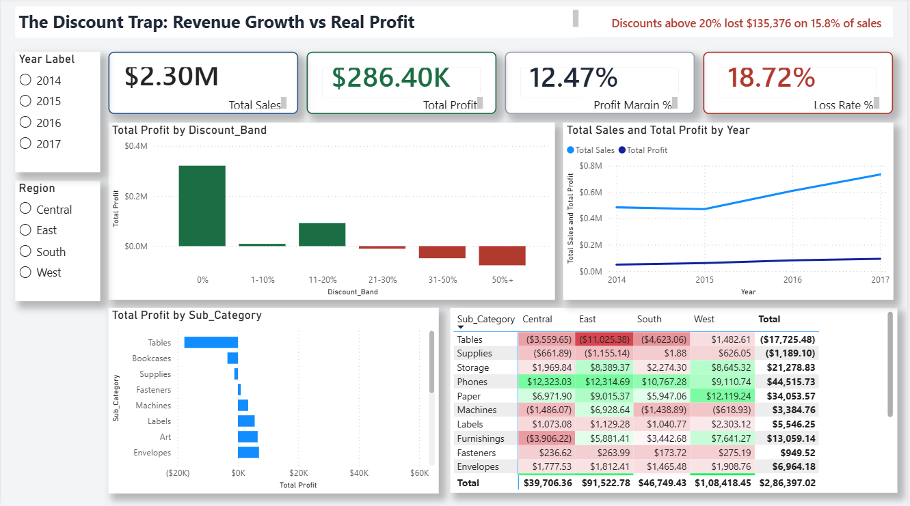

# The Discount Trap: Revenue Growth vs Real Profit

**Question:** Does discounting actually grow the business, or does it buy revenue while destroying profit?

**Dataset:** [Sample Superstore (Kaggle)](https://www.kaggle.com/datasets/konstantinognev/sample-superstorecsv) | 9,994 order lines, 2014 to 2017
**Tools:** Python (pandas, matplotlib, seaborn), SQL (SQLite), Power BI

---

## Executive summary

Sales grew 51% from 2014 to 2017, but discounting was hiding a profit leak. Order lines discounted above 20% made up 15.8% of sales yet lost $135,376, while orders with no discount earned $320,988. Higher discounts did not increase quantity per order (about 3.7 to 4.0 units in every band). Capping discounts at 20% and fixing Tables, Bookcases, and the Central region could recover roughly $135K or more in profit.

## Key numbers

| Metric | Value |
|---|---|
| Total sales | $2,297,201 |
| Total profit | $286,397 |
| Overall profit margin | 12.47% |
| Average discount | 15.6% |
| Loss-making order lines | 18.7% of all lines (1,871) |
| Avg discount on loss-making lines | 48.1% (vs 8.1% on profitable lines) |

## Key findings

### 1. Profit flips negative above a 20% discount

| Discount band | Order lines | Profit | Margin | Loss rate |
|---|---|---|---|---|
| 0% | 4,798 | $320,988 | 29.5% | 0% |
| 1-10% | 94 | $9,029 | 16.6% | 4.3% |
| 11-20% | 3,709 | $91,756 | 11.6% | 14.0% |
| 21-30% | 227 | -$10,369 | -10.1% | 91.6% |
| 31-50% | 310 | -$48,448 | -24.8% | 91.6% |
| 50%+ | 856 | -$76,559 | -119.2% | 100% |



### 2. Discounts did not increase quantity

Average quantity per order line stays between 3.7 and 4.0 units in every discount band. Deep discounts cost profit without a visible lift in volume.

### 3. The damage is concentrated

- **Tables** (-8.6% margin, 26.1% avg discount) and **Bookcases** (-3.0% margin, 21.1% avg discount) lose money despite high sales.
- **Central region** has the highest average discount (24.0%) and the lowest margin (7.9%). West has a 10.9% average discount and a 14.9% margin.
- The worst region and sub-category combination is **East Tables**: -$11,025 on a 37.4% average discount.
- **Supplies** loses money with only a 7.7% average discount, so its problem is pricing or cost, not discounting.
- **Binders** have a 37.2% average discount but still earn a 14.9% margin, so heavy discounting is not equally harmful everywhere.



### 4. Margin slipped in 2017

| Year | Sales | Profit | Margin |
|---|---|---|---|
| 2014 | $484,247 | $49,544 | 10.2% |
| 2015 | $470,533 | $61,619 | 13.1% |
| 2016 | $609,206 | $81,795 | 13.4% |
| 2017 | $733,215 | $93,439 | 12.7% |

Sales grew 20.4% in 2017 but profit grew only 14.2%.

## Recommendations

| # | Finding | Action | Impact |
|---|---|---|---|
| 1 | Discounts above 20% lose money (1,393 lines, 15.8% of sales, -$135,376) | Cap discounts at 20% | ~$135K recovered (up to $219K best case) |
| 2 | Discounts don't increase quantity | Stop using deep discounts to drive volume | Removes the cost with no volume gain |
| 3 | Tables and Bookcases lose money | Reduce discounts and reprice | Stops ~$21K in losses |
| 4 | Central region discounts the most | Region-specific discount limit | If Central matched South's 11.9% margin, roughly $20K more profit (501,240 x (11.93% - 7.92%)) |
| 5 | Promotions hit low-margin products | Shift promotions to Labels, Paper, Envelopes, Copiers (37% to 44% margin) | Better profit per sale |
| 6 | Sales tracked without margin | Add profit margin as a core KPI and flag orders above 20% discount | Earlier warning |

## Dashboard



The Power BI dashboard (`dashboard/discount-trap.pbix`) includes KPI cards (sales, profit, margin, loss rate), profit by discount band, sub-category profit, a region by sub-category heatmap, and a yearly trend.

## Method

1. **Load and clean** the data in pandas: standardise column names, convert dates, remove duplicates.
2. **Build metrics:** profit margin, loss flag, and discount bands (0%, 1-10%, 11-20%, 21-30%, 31-50%, 50%+).
3. **Analyse** profit by discount band and exact discount level to find the break-even point.
4. **Locate the damage** by sub-category, region, and region x sub-category.
5. **Test the volume claim:** compare average quantity across discount bands.
6. **Simulate a discount cap** at 20% to estimate recovered profit.
7. **Cross-check in SQL:** the same analysis is reproduced in `sql/analysis.sql` (12 queries), and results match the pandas output.

## Assumptions and limitations

- The cap simulation assumes the same quantity sold at the capped price. This overstates recovery for very deep discounts (an 80% discount would mean a 4x price rise), so $219K is an upper bound. The conservative estimate of about $135K assumes the loss-making lines break even.
- Costs are inferred as sales minus profit, because the dataset has no cost breakdown.
- Quantity per order line shows discounts don't raise units per line, but the data cannot show whether discounts attract more orders overall.
- Each row is an order line, not a unique order.
- It is a sample dataset, so results show a pattern, not an exact business forecast.

## Project structure

```
discount-trap/
├── data/
│   └── Sample - Superstore.csv
├── notebooks/
│   └── analysis.ipynb
├── sql/
│   └── analysis.sql
├── dashboard/
│   └── discount-trap.pbix
├── images/
│   ├── profit-by-discount-band.png
│   ├── region-subcategory-heatmap.png
│   └── dashboard-preview.png
└── README.md
```

## How to run

1. Open `notebooks/analysis.ipynb` in Google Colab or a local Jupyter setup.
2. Upload `data/Sample - Superstore.csv`. In Colab, load it with `pd.read_csv("Sample - Superstore.csv", encoding="latin-1")`. In the repo folder layout, use `pd.read_csv("../data/Sample - Superstore.csv", encoding="latin-1")`.
3. Run the cells in order: load, clean, save to SQLite with `df.to_sql("superstore", conn, if_exists="replace", index=False)`, then run the queries from `sql/analysis.sql`.
4. Open `dashboard/discount-trap.pbix` in Power BI Desktop to explore the dashboard.

## Resume summary

Analyzed 9,994 retail order lines using Python and SQL; found that discounts above 20% made up 15.8% of sales but lost $135K, with no lift in order quantity; recommended a 20% discount cap and repricing of Tables and Bookcases.

## Data source

Sample Superstore dataset from Kaggle. Credit to the original dataset publisher.
